<div align="center">

# ⚡ Cascadia

### Real-time cascading-blackout risk for power grids with a physics-informed graph neural network

A **live digital twin of the IEEE 118-bus transmission grid**. Its protection relays behave stochastically, so the same fault can fizzle out or black out a region. A **graph neural network** estimates the *probability* that each line fails in the resulting cascade for every possible single failure. It does this **112× faster than a 100-run Monte Carlo study**, with an expected calibration error below 0.001. A horizontally scaled streaming backend runs it every second, and an **AI operator copilot** explains the risks.

[](https://github.com/piyushd12/cascadia/actions/workflows/ci.yml)


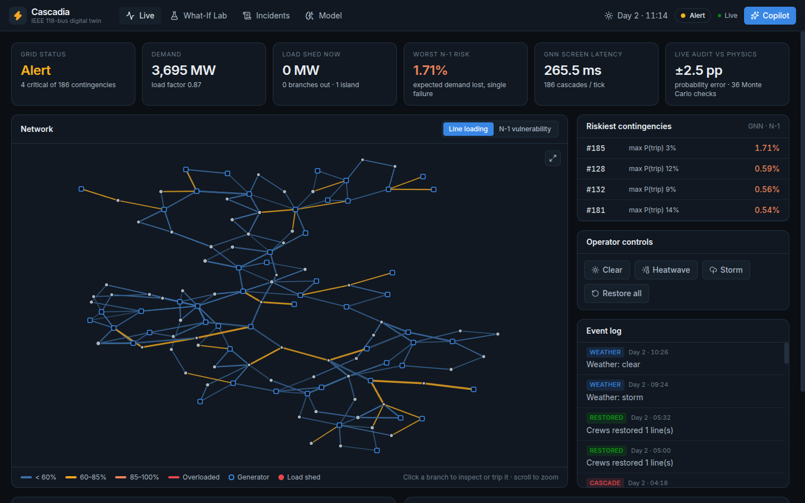

</div>

---

## Contents

- [Why this matters](#why-this-matters)
- [What Cascadia does](#what-cascadia-does)
- [Results](#results)
- [System architecture](#system-architecture)
- [The machine-learning pipeline](#the-machine-learning-pipeline)
- [Tour of the app](#tour-of-the-app)
- [Quick start](#quick-start)
- [API reference](#api-reference)
- [Project structure](#project-structure)
- [Design decisions](#design-decisions)
- [Engineering notes](#engineering-notes)
- [Limitations and roadmap](#limitations-and-roadmap)

---

## Why this matters

Large blackouts rarely have a single cause. One line trips, often because of a fault, a storm or a tree. Its power **redistributes instantly** onto neighbouring lines and can overload them. Their protection relays then trip them too. Within minutes a local problem can become a regional blackout:

| Event | People affected | How it spread |
|---|---|---|
| Western US (WSCC), 1996 | millions, in two events | Lines sagged into trees, and relay misoperations helped the outages spread |
| Northeast US & Canada, 2003 | ~50 million | A handful of lines sagged into trees, and the overloads cascaded across eight states |
| Northern India, 2012 | ~600 million | A tie line overloaded and tripped, then the grid split into islands |

Cascades are **random**. Relays tolerate short overloads by different amounts, and relays next to a failure sometimes trip when they shouldn't. These *hidden failures* turned local problems into the 1996 and 2003 blackouts. The same contingency can therefore end harmlessly in one realisation and black out a region in another. The useful question for an operator is not *"what will happen?"* but ***"how likely is each outcome?"***

Physics can only answer that by **Monte Carlo**: simulate the cascade many times per contingency, for all 186 single-line contingencies, continuously as demand and weather change. That costs tens of seconds per screen on a laptop.

**Cascadia learns it.** A graph neural network trained on 640,000 simulated cascades predicts every line's failure probability, and the expected load lost, for all 186 contingencies in one batched inference.

## What Cascadia does

- 🧮 **A physics engine:** DC power flow with islanding and load shedding, validated against [pandapower](https://www.pandapower.org/) to within 10⁻¹¹ MW. It drives a quasi-static cascade simulator with **stochastic protection** (after the Chen–Thorp–Dobson hidden-failure model). Exact LODF/PTDF sensitivities compute every first-stage outage flow in about 1 ms.
- 🧠 **CascadeGNN:** an edge-centric message-passing network with a global context vector. For every line it predicts *P(this line fails in the cascade)*, and for the whole grid it predicts *the expected fraction of demand lost*. It is trained with a proper scoring rule on multi-draw cascade frequencies, Platt-calibrated, exported to ONNX and served on CPU.
- 🌐 **A live digital twin:** a day/night demand cycle, heatwaves, storms, random faults, cascades, repair crews and **operator restoration logic**, all streamed through Redis Streams.
- 📡 **A horizontally scaled risk engine:** workers in a Redis consumer group screen the full N-1 set every tick. They also **audit the GNN against Monte Carlo physics in production**, and the shared audit totals appear on the dashboard as *live accuracy*.
- 🧪 **A What-If Lab:** trip any lines at any demand level. You see the GNN's probabilities next to a 100-run Monte Carlo, then replay one random realisation stage by stage.
- 🤖 **An Operator Copilot:** a Claude-powered agent whose tools call the real simulator and model. Ask *"would 5% demand response make us N-1 secure?"* and it measures the answer before replying.
- 🗄️ **Incident history** persisted in Postgres, and a **one-command deployment** with Docker Compose.

## Results

All numbers are measured on held-out test data never seen during training, and are reproducible with `make model`. The physics reference for probabilities is an independent **128-run Monte Carlo** per scenario.

| | |
|---|---|
| **Full N-1 screen** (186 contingencies) | **239 ms** with the GNN vs **26.7 s** for a 100-run Monte Carlo: **112× faster** |
| Monte Carlo budget with the same accuracy | **~8 runs per contingency (2.1 s): the GNN is 9× cheaper** |
| Failure-probability error vs the 128-run reference | **5.0 pp** mean absolute error, correlation **0.905** |
| Expected load-shed error | **0.41 pp** of demand, correlation **0.969** |
| Calibration (10,000 test scenarios) | expected calibration error **0.0009**, Brier score 0.024 |
| Ranking realised failures (base rate 4.8%) | PR-AUC **0.697**, ROC-AUC **0.962** |
| Model | 95,906 parameters, a 0.64 MB ONNX file, CPU-only serving |

<p align="center">
  <picture>
    <source media="(prefers-color-scheme: dark)" srcset="docs/figures/speedup-dark.png">
    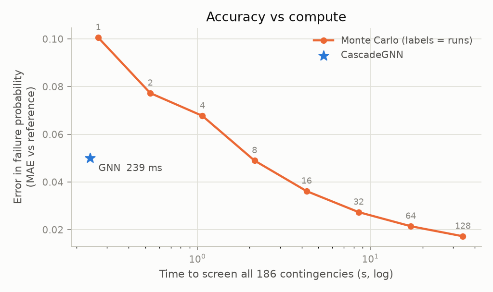
  </picture>
</p>

**How to read this.** The orange curve is Monte Carlo physics with 1–128 runs per contingency: more runs mean less error but more time. The GNN (blue star) costs about as much as **one** physics run yet is as accurate as **eight**. When you need near-exact probabilities, physics still wins: Cascadia uses it in the What-If Lab and the live audit. For continuous screening, every second, the GNN is the only option that fits the budget.

<table>
<tr>
<td width="50%">
<picture>
  <source media="(prefers-color-scheme: dark)" srcset="docs/figures/mc_agreement-dark.png">
  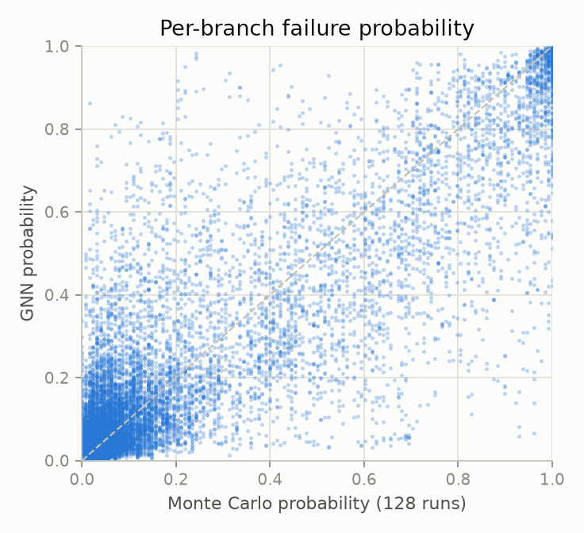
</picture>
</td>
<td width="50%">
<picture>
  <source media="(prefers-color-scheme: dark)" srcset="docs/figures/calibration-dark.png">
  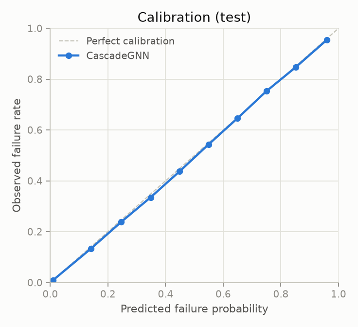
</picture>
</td>
</tr>
<tr>
<td width="50%">
<picture>
  <source media="(prefers-color-scheme: dark)" srcset="docs/figures/load_shed-dark.png">
  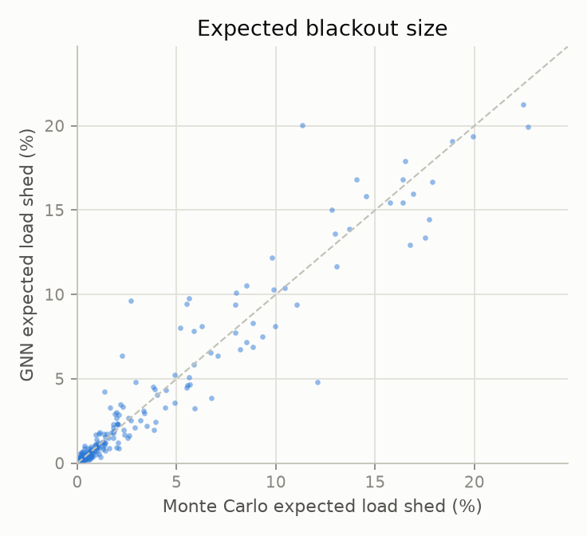
</picture>
</td>
<td width="50%">
<picture>
  <source media="(prefers-color-scheme: dark)" srcset="docs/figures/training-dark.png">
  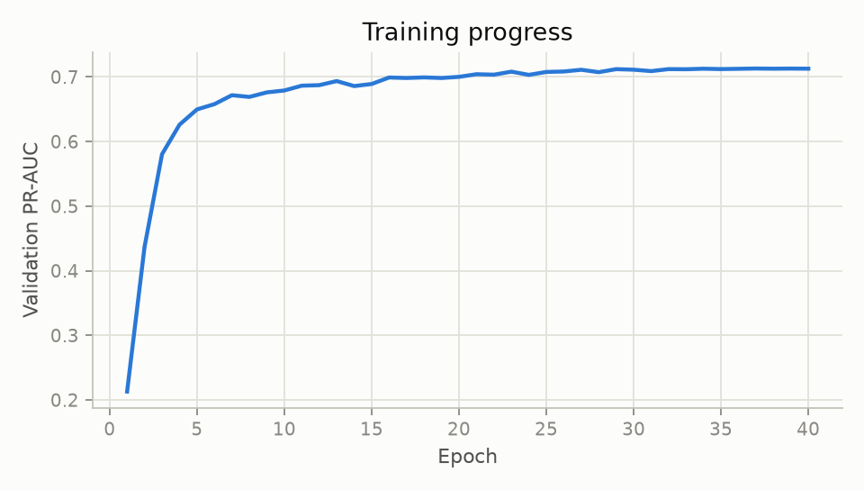
</picture>
</td>
</tr>
</table>

> **Why isn't PR-AUC close to 1?** Outcomes are random. A line with a true 40% failure probability fails in some realisations and survives in others, so even a *perfect* probability model cannot rank realised outcomes perfectly. Calibration and agreement with Monte Carlo are the meaningful accuracy measures here. PR-AUC is reported for completeness.

## System architecture

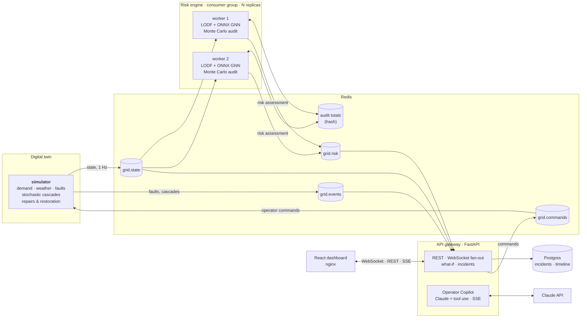

Each tick of the simulation flows through the system like this:

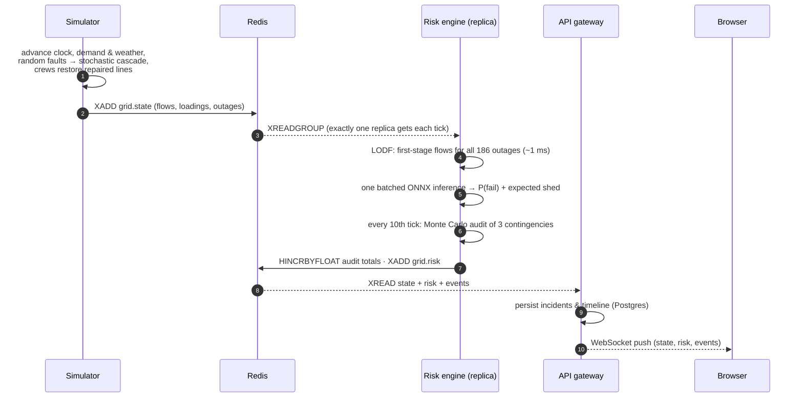

**Why it's built this way:**

- **Redis Streams with consumer groups.** The simulator never waits for inference. Risk workers scale horizontally, and each tick is screened by exactly one replica. A worker that falls behind skips to the newest state instead of queueing stale work.
- **Shared audit state.** Replicas see interleaved ticks, so each keeps its own audit schedule. The audit *totals* live in one Redis hash, so the dashboard shows a single live-accuracy figure no matter which replica answered.
- **ONNX Runtime on CPU for serving.** The serving image has no PyTorch or CUDA (540 MB including SciPy), and one batched call screens every contingency.
- **Graceful degradation.** Without Redis the API still serves what-if analysis on a nominal operating point. Without Postgres it keeps incidents in memory. Without an API key the Copilot reports that it is disabled and everything else keeps working.
- **Backpressure on WebSockets.** Every client has a bounded queue, so a slow browser drops frames instead of slowing everyone else down.

## The machine-learning pipeline

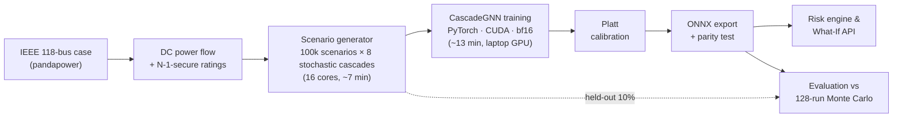

**Data.** Each scenario samples a demand level, mostly between 0.75× and 1.28× nominal, with log-normal per-bus noise. It applies 0–2 pre-existing outages and lets the grid settle into a stable but degraded state, then trips 1–3 more lines. The cascade is then simulated **8 times with independent random protection behaviour**. The label for each line is the fraction of those 8 runs in which it failed, a soft probability target. The graph-level label is the mean fraction of demand lost.

**Model.**

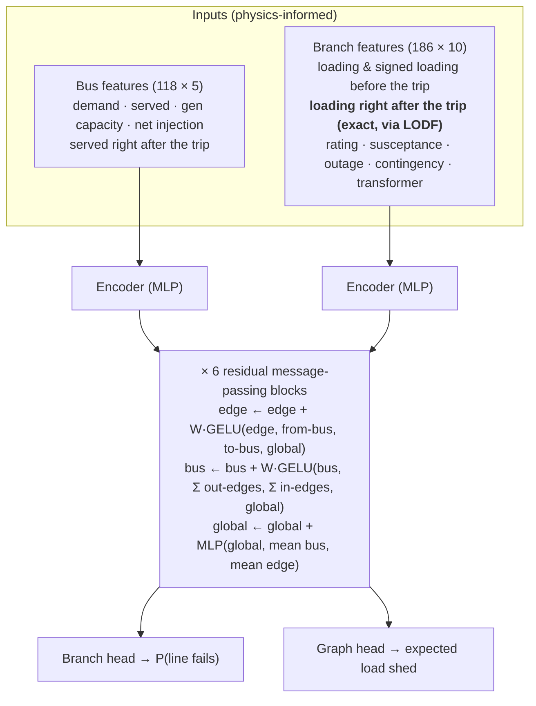

- **Physics does the first step exactly.** The first stage of a cascade, where the tripped lines' power redistributes, is linear and is computed exactly with line outage distribution factors. The network only has to learn what physics can't give in closed form: the random, nonlinear sequence of stages that follows.
- **Edges carry the state.** A cascade is a property of lines, so branches hold their own hidden states and update them from both endpoint buses.
- **A global context vector.** Flow redistribution is non-local: a trip can overload a line ten hops away.
- **A fixed topology with outage masks.** Out-of-service lines are marked with a feature flag instead of being deleted. Message passing becomes dense batched matrix multiplication with constant incidence matrices, which exports to ONNX with no custom operators.
- **A proper scoring rule.** Binary cross-entropy on soft labels is minimised by the true probability, so the network learns calibrated probabilities directly. The fitted Platt correction is almost the identity (a = 0.97, b = −0.006).

## Tour of the app

| Live monitor | What-If Lab |
|---|---|
|  | 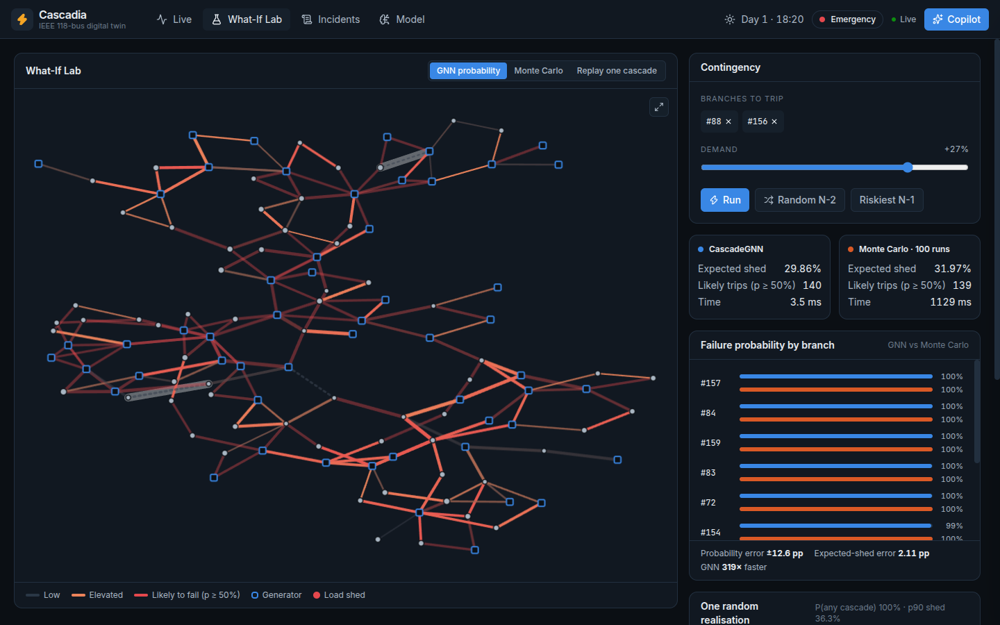 |
| Line loadings and an N-1 vulnerability heat-map. KPIs, the riskiest contingencies, the live Monte Carlo audit, operator controls (weather, faults, restore) and the event log. | Pick lines and scale demand. GNN probabilities and a 100-run Monte Carlo appear side by side: here 29.9% vs 32.0% expected demand lost, in **3.5 ms vs 1.1 s**. |

| Cascade replay | Model card |
|---|---|
| 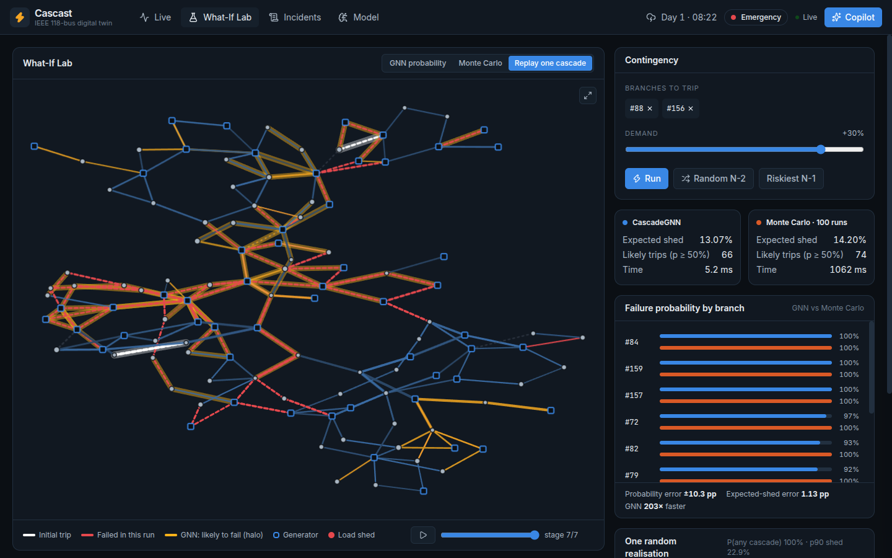 | 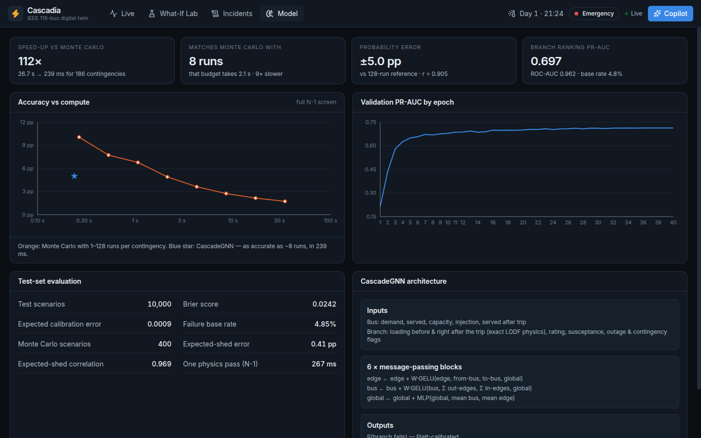 |
| One random realisation, stage by stage. White marks the initial trips, red marks lines that failed in this run, and amber halos mark the lines the GNN said were likely to fail. | Accuracy vs compute, the training curve, test-set metrics and the architecture, all served from the evaluation run. |

<p align="center">
  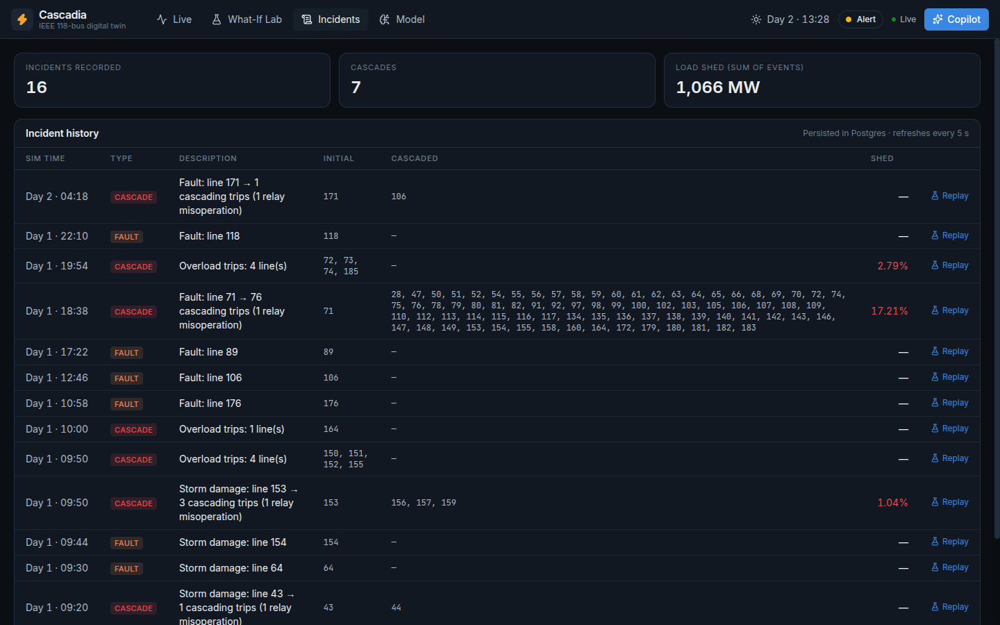<br/>
  <sub>Incident history, persisted in Postgres. Each entry links back into the What-If Lab.</sub>
</p>

**Operator Copilot.** This is a Claude agent with four tools: `get_grid_status`, `simulate_contingency`, `inspect_line` and `evaluate_load_relief`. It streams its answer over Server-Sent Events and shows each tool call as it happens. Every number it quotes was computed by the GNN or the physics engine. Set `ANTHROPIC_API_KEY` to enable it.

## Quick start

### Run everything with Docker (recommended)

```bash
git clone https://github.com/piyushd12/cascadia.git
cd cascadia
cp .env.example .env            # optional: add ANTHROPIC_API_KEY to enable the Copilot
docker compose up --build
```

Open **http://localhost:8080**. The trained model ships in `backend/artifacts/`, so no GPU or training is needed.

> The stack binds to `127.0.0.1` only, and the API answers only to `localhost` Host headers (DNS-rebinding protection). It has no authentication, so to demo it on a LAN you trust, change the `web` port to `"8080:80"` in `docker-compose.yml` and add your IP to `CASCADIA_ALLOWED_HOSTS` in `.env`.

### Local development

Requirements: Python 3.12 with [uv](https://docs.astral.sh/uv/), [Bun](https://bun.sh), and Docker for Redis and Postgres.

```bash
make setup        # backend + frontend dependencies
make infra        # Redis + Postgres in Docker
make api          # terminal 1: FastAPI on :8000
make simulator    # terminal 2: the digital twin
make risk         # terminal 3: a risk-engine worker (start more to scale out)
make web          # terminal 4: Vite dev server on :5173
```

### Reproduce the model

```bash
make model        # grid export → 800k cascades → train → ONNX export → evaluation & figures
make test         # physics, simulator, risk engine, inference and API tests
```

Data generation takes about 7 minutes on 16 CPU cores. Training takes about 13 minutes on a laptop RTX 3050 (4 GB), and also runs on CPU.

## API reference

| Method | Endpoint | Description |
|---|---|---|
| `GET` | `/api/health` | Service status (live feed, Redis, Postgres, Copilot) |
| `GET` | `/api/grid` | Topology, ratings and layout of the 118-bus grid |
| `GET` | `/api/state` | Latest operating point, risk assessment and recent events |
| `POST` | `/api/whatif` | `{"lines": [88, 156], "load_scale": 1.2}`: GNN prediction, 100-run Monte Carlo, one replayable realisation |
| `GET` | `/api/lines/{id}` | One branch: endpoints, rating, flow, loading, vulnerability |
| `GET` | `/api/incidents` | Persisted faults and cascades |
| `GET` | `/api/timeline` | Demand, served load and risk history |
| `GET` | `/api/model` | Test metrics, benchmark and training history |
| `POST` | `/api/commands` | Operator commands: `{"cmd": "trip", "lines": [7]}`, `{"cmd": "weather", "value": "storm"}`, `{"cmd": "restore_all"}` |
| `POST` | `/api/copilot` | Chat with the Operator Copilot (Server-Sent Events) |
| `WS` | `/ws/live` | Live stream of `state`, `risk` and `event` messages |

Interactive OpenAPI docs are served at `/docs` on the API (port 8000).

## Project structure

```
cascadia/
├── backend/
│   ├── src/cascadia/
│   │   ├── grid/          # IEEE-118 export, DC power flow + LODF, stochastic cascade simulator
│   │   ├── ml/            # scenario generation, features, CascadeGNN, training, evaluation, ONNX
│   │   ├── services/      # Redis bus, digital-twin simulator, risk engine
│   │   └── api/           # FastAPI gateway, Postgres store, what-if ops, Claude copilot
│   ├── artifacts/         # grid.json, model.onnx, metrics.json (shipped)
│   └── tests/
├── frontend/              # React 19 + TypeScript + Tailwind v4 dashboard
│   └── src/{components,pages,lib}
├── docs/                  # figures and screenshots used in this README
├── docker-compose.yml     # redis · postgres · simulator · risk-engine ×2 · api · web
└── Makefile
```

## Design decisions

<details>
<summary><b>Why model protection stochastically?</b></summary>

With deterministic protection (every line trips at exactly 100% loading) a cascade is a pure function of the operating point, and one physics run gives the exact answer. Real protection is not like that. Relays and conductors tolerate short overloads by varying amounts, and relays next to a fault can misoperate. Cascadia draws each line's trip threshold as τ = 1 + 0.06·|z|, and gives every relay adjacent to a newly tripped line a 2% chance of a hidden failure. Risk then becomes a probability, and the problem the GNN solves changes from "replace one simulation" to "replace a Monte Carlo study". That is where a learned surrogate pays off.
</details>

<details>
<summary><b>Why a DC power-flow model?</b></summary>

The DC approximation (lossless lines, flat voltages, small angle differences) is the standard model in contingency screening and in cascading-failure research such as OPA. It is linear, so one cascade stage is a single sparse solve, and the effect of any outage on every flow follows exactly from PTDF/LODF sensitivity factors. That makes it possible to simulate 800,000 cascades in about 7 minutes. The solver is cross-checked against pandapower's `rundcpp` every time the case is exported.
</details>

<details>
<summary><b>Where do the line ratings come from?</b></summary>

The IEEE 118-bus case ships without realistic thermal limits. Cascadia sets each rating to the larger of 1.05 × the worst flow that line sees across all single-line outages, and 1.3 × its base-case flow. The base grid is therefore **N-1 secure by construction**, which is how real grids are planned, and it stays intact up to 1.25× nominal demand. Cascades appear only under stress (peaks, heatwaves) or multiple outages, as they do in reality. Tests check both properties.
</details>

<details>
<summary><b>Why feed the network exact first-stage physics?</b></summary>

The flows immediately after a trip are linear in the operating point, and LODFs give them exactly for all 186 contingencies in about 1 ms. Making a network learn this from data wastes capacity and accuracy. In an early development ablation with deterministic protection, the model without these features reached a validation PR-AUC of about 0.58; with them it reached 0.83.
</details>

<details>
<summary><b>How is the model kept honest in production?</b></summary>

Every 10th tick it processes, each risk-engine replica replays the two riskiest contingencies and one random contingency through a 40-run Monte Carlo. It adds the errors to shared totals in Redis. The dashboard shows the running probability error as **live accuracy**, so drift shows up immediately. The What-If Lab always shows a 100-run Monte Carlo next to the GNN.
</details>

<details>
<summary><b>How does the digital twin recover from blackouts?</b></summary>

Like a real control room. A repaired line is re-closed only if that creates no new overload. Lines are switched as corridors (all ready lines, then all ready lines at a bus, then single lines), because closing one tie into an island would push the island's whole re-dispatch through it. If restoration stays blocked for two simulated hours, a coordinated *system restoration* re-energises everything at once, provided that step is safe. A regression test trips 47 lines and checks that the grid recovers within four hours.
</details>

<details>
<summary><b>Why is the Copilot built on tools?</b></summary>

An LLM should not guess at power flows. The Copilot calls the same functions the dashboard uses (grid status, contingency simulation, line inspection, demand-response evaluation), so every number it quotes was computed, not generated.
</details>

## Engineering notes

Some of the more instructive bugs found and fixed while building this:

- **Thread oversubscription, 100× slowdown.** NumPy's OpenBLAS starts a thread per core. On 118×118 matrices, with four services per host, the threads only contend. Pinning BLAS to one thread per process took the simulator tests from 222 s to 2 s, and the what-if endpoint from over two minutes to 0.4 s. The pin lives in the package `__init__`, so it applies before NumPy loads, whatever the entry point.
- **A gameable checkpoint metric.** Selecting checkpoints by probability error on "active" edges, where the mask included edges the model predicted above 0.5%, rewarded an undertrained, underconfident epoch-2 model that shrank its own evaluation set. Selecting on validation cross-entropy over all edges fixed it. The calibration correction then collapsed to almost the identity.
- **Restoration deadlock.** The first version of the twin re-closed repaired lines blindly. They re-tripped within one tick, about 2,700 times a simulated day, and the grid never recovered: about 70 of 186 lines stayed out, and roughly 10% of demand went unserved. Overload-aware, corridor-based restoration brought the average number of lines out down to about 6.

## Limitations and roadmap

- **DC physics only.** There is no voltage collapse, reactive power or dynamics. An AC power-flow model would capture voltage-driven cascades.
- **One grid.** The model is trained for a single topology. Training across grids (IEEE 39, 300, PEGASE) with the same topology-agnostic message passing is the natural next step.
- **N-1 screening.** The same model can rank N-2 pairs (about 17,000) in seconds, which would be a useful extension for planning studies.
- **Remedial actions.** The next stage is to recommend actions as well as estimate risk, for example by gradient-based redispatch through the differentiable surrogate.

## Tech stack

**ML:** PyTorch 2.11 (CUDA, bf16), ONNX / ONNX Runtime, scikit-learn, pandapower, NumPy/SciPy · **Backend:** FastAPI, Pydantic v2, Redis Streams, SQLAlchemy 2 (async) + Postgres, Anthropic SDK · **Frontend:** React 19, TypeScript, Vite 8, Tailwind CSS v4, TanStack Query, Zustand, Recharts, d3-zoom · **Infra:** Docker Compose, nginx, GitHub Actions, uv, Bun

## License

[MIT](LICENSE) © Piyush ([@piyushd12](https://github.com/piyushd12))
